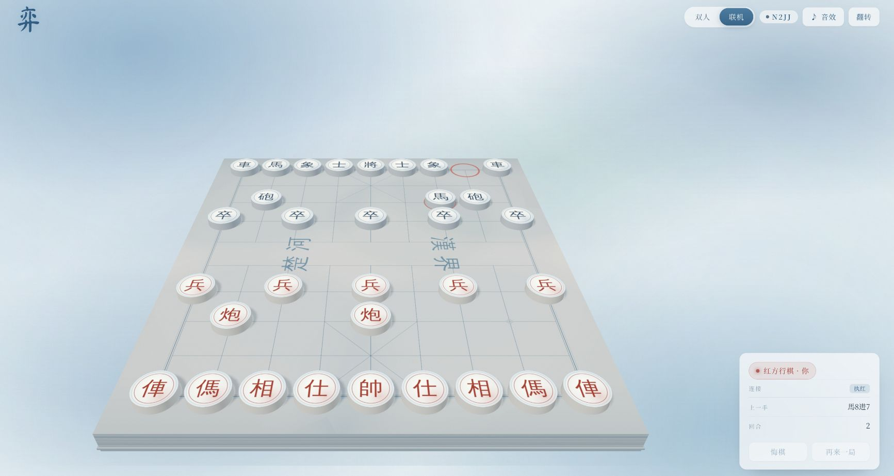
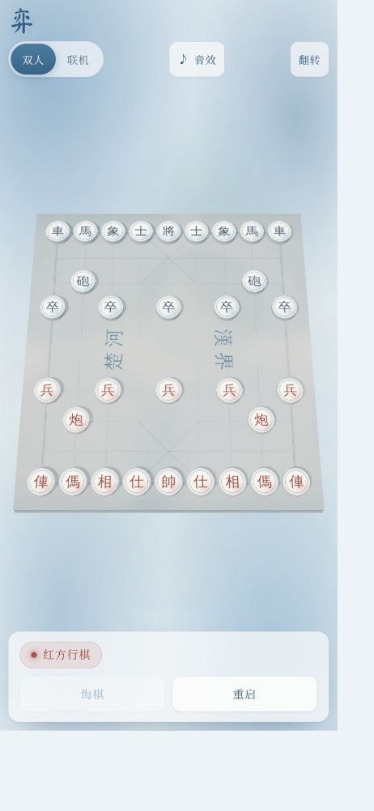
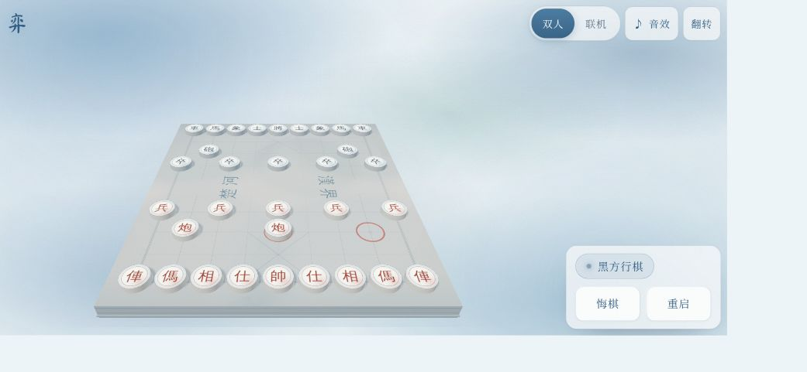

# 弈 · 三维中国象棋

一套浏览器端的三维中国象棋：**Three.js 渲染 + Rapier 物理特效 + Colyseus 权威服务端 + 自研变体规则引擎**。



三层结构各自独立，任何一层都可以单独替换：

| 层 | 职责 | 代码 |
|---|---|---|
| 规则引擎 | 走子生成、将军/将死/困毙、重复与无吃子判和、中文记谱（另含 Alpha-Beta 搜索，暂未接入界面） | `packages/rules` |
| 呈现层 | Three.js 场景、拾取、落子动画、Rapier 吃子抛掷、Web Audio 音效、DOM HUD | `apps/web` |
| 权威服务端 | 房间/座位、走子校验、FEN 广播、断线重连、和棋与认输 | `packages/server` |

> 物理只负责"好看"：被吃的棋子会变成刚体飞出去，但**胜负永远只由规则引擎决定**。服务端不加载 Rapier。

---

## 快速开始

```bash
pnpm install

# 终端 1：权威服务端（默认 ws://0.0.0.0:2567）
pnpm run server

# 终端 2：前端开发服务器（http://localhost:5173）
pnpm dev

# 测试 / 类型检查 / 生产构建
pnpm test
pnpm typecheck
pnpm build
```

服务端地址可用 `VITE_SERVER_URL` 覆盖；端口用 `PORT`、绑定地址用 `HOST` 覆盖。

---

## 架构

```
浏览器 (apps/web)
┌───────────────────────────────────────────────────────────┐
│                                                           │
│ main.ts          模式切换（双人 / 联机）、消息编排        │
│  ├── game/game.ts    Three.js 场景 + 交互 + 动画 + 物理   │
│  │    ├── engine/*   棋盘、棋子、光照、Rapier 世界        │
│  │    └── @xiangqi/rules   本地即时校验（点击即反馈）     │
│  ├── audio/sound.ts       Web Audio 合成音效（可静音）    │
│  └── net/online.ts        Colyseus 客户端（按需动态加载） │
│                                                           │
└────────────┬──────────────────────────────────────────────┘
             │ WebSocket，纯 JSON 消息，无 schema
┌────────────▼──────────────────────────────────────────────┐
│  服务端 (packages/server)                                 │
│   XiangqiRoom：唯一的 Position 实例，所有着法都在这里校验 │
│   @xiangqi/rules：与服务端同源的规则引擎                  │
└───────────────────────────────────────────────────────────┘
```

### 前端也在跑规则引擎，为什么还要服务端？

前端的 `Position` 用于选子和合法落点提示。联机模式提交 UCI 后锁定输入，收到服务端 FEN 才更新棋盘、播放落子动画和音效；拒绝走子后请求快照恢复输入。等待对手、断线、观战和非己方回合都不能操作棋子。

---

## 规则引擎（`packages/rules`）

零依赖、确定性，同一份代码在服务端、Worker、浏览器里跑。核心是 `VariantConfig`：

```ts
export interface VariantConfig {
  id: string;
  name: string;
  width: number;
  height: number;
  startFen: string;
  hasRiver: boolean;          // 限制象/启用兵横走
  elephantEyeBlocks: boolean; // 塞象眼
  noCaptureLimit: number;     // 无吃子判和（半回合）
  repetitionLimit: number;    // 重复判和
}
```

走子生成只认 `Geometry`（由配置推导），不写死 9×10，所以新增变体不需要复制引擎。已实现：

- `xiangqi` — 9×10 标准中国象棋
- `minixiangqi` — 7×7 迷你象棋（Fairy-Stockfish 同名变体）

**着法编码**：`Move = from | (to << 7)`，单整数，搜索和置换表里都能直接用。

**UCI 坐标**从红方底线开始编号（`a0` 是红方左车），与引擎内部"rank 0 = 黑方底线"互为镜像——`squareToUci()` 负责这个转换。

**记谱**：`toChineseNotation()` 在走子**之前**求值（它需要旧局面来判断前后/进退），输出如 `炮二平五`、`馬8进7`。

**搜索**：迭代加深 + 置换表 + 空着裁剪 + 后期减深 + 吃子静态搜索，按时间预算运行。代码仍在 `packages/rules` 里且有测试覆盖，但**界面目前不接**——见文末「已知取舍」。

**验证**：

- Perft 与 Fairy-Stockfish 逐节点对齐：开局深度 1–4 = 44 / 1920 / 79 666 / 3 290 240
- 变体（7×7）同样对表
- 64 个测试全部通过（含联机生命周期回归）（`pnpm test`）

---

## 三维呈现（`apps/web`）

- **场景**：蓝色水彩纸背景、浅色棋盘、瓷白棋子，暖色日光和蓝色补光。棋字独立保留墨色对比，背景由 CSS 色晕和纸纹生成；`PCFShadowMap` 提供柔和投影。
- **拾取**：射线打在拍平的 `pickPlane` 上，再用 `board.group.worldToLocal()` 把交点转回棋盘坐标系（拍平面自身被 `-PI/2` 旋转过，直接用它的局部坐标会把纵深放到 `y` 上）。
- **视角**：红方在 +z、黑方在 -z。联机执黑自动坐到对面；`翻转视角`是**硬切**而不是缓动——缓动 180° 期间点击会按旧相机取格子。
- **动画**：落子是位移动画，吃子在落子回调里把被吃棋子交给 Rapier 变成刚体抛出。Rapier 约 4.3 MB，所以 `game.ts` 用 `import()` 懒加载，首屏不等它；加载失败也只是少了抛掷效果。
- **HUD**：纯 DOM，保证中文排版和焦点环；分段控件切换双人/联机。1000px 以下使用上方工具栏和下方操作区，矮横屏改为右侧操作区；棋盘独占剩余视口并按实际画幅取景，保留安全区。
- **房间弹窗**：新建、房号加入和等待状态共用一张水彩卡片。关闭弹窗保留房间，只有「离开」或切回双人模式才退出；双方就位后自动收起。支持 Esc、Tab 焦点循环和取消连接。邀请链接会预填房号。
- **音效**：不加载任何音频文件，全部用 Web Audio 现场合成——噪声脉冲做木头撞击的起振，快速下滑的正弦做质量感。落子、吃子（双击）、将军（铃音）、终局（琶音）各一。`AudioContext` 在第一次发声时才创建，所以静音用户不会打开音频设备；开关状态存在 `localStorage['xiangqi.sound']`，刷新后保留。

构建产物（懒加载后）：

| chunk | 体积 | gzip |
|---|---|---|
| `index`（Three.js + 规则 + UI + 音效） | 约 582 kB | 约 151 kB |
| `physics`（Rapier wasm，按需） | 4 335 kB | 1 670 kB |
| `online`（Colyseus SDK，按需） | 171 kB | 54 kB |

---

## 权威服务端（`packages/server`）

`XiangqiRoom` 刻意**不使用** `@colyseus/schema`：`Room` 只有在 `this.state` 被赋值时才推送全量状态，默认序列化器就是 `"none"`，所以这里是一套纯消息协议，客户端与服务端之间没有 schema 版本耦合。

### 座位与房间

- 房间码即 `roomId`（4 位，去掉易混字符）。前端「新房间」使用 SDK `create()` 创建独立桌，「进入」使用 `joinById(code)` 加入现有房间。无效或过期房号报错，不会悄悄创建新桌。
- 服务端保留 `filterBy(['code'])` 供其他客户端按码匹配；当前前端不使用自动配桌。
- 先到者执红，第二个执黑，其余观战；上限 8 人。

### 消息（客户端 → 服务端）

| 消息 | 载荷 | 说明 |
|---|---|---|
| `move` | `{ uci }` | 着法，服务端全量校验（座位、轮次、合法性） |
| `resign` | — | 认输 |
| `rematch` | — | 请求再来一局（双方都点才重开） |
| `chat` | `{ body }` | 最长 160 字 |
| `sync` | — | 请求补发 `seats` + `snapshot` |

`sync` 的存在是为了消除加入时的竞态：`onJoin` 里发的消息会先于客户端挂上监听器到达。客户端连上后立刻 `sync`，从头拿到完整画面。

### 消息（服务端 → 客户端）

| 消息 | 内容 |
|---|---|
| `snapshot` | 全量局面：`fen`、`sideToMove`、`status`、`lastMove`、`notation`、`moveNumber`、`seats`、`clocks`、`gameOver` |
| `move` | 被接受的着法 + 走完后的 FEN/状态/时钟 |
| `seats` | 双方名字、观战人数、**你的座位** |
| `reject` | 拒绝原因（`还没轮到你` / `不合规则的着法` / `对局已结束` …） |
| `reset` | 重开后的 FEN |
| `event` | `joined` / `left` / `resign` / `timeout` / `forfeit` / `rematch-pending` / `rematch` |
| `chat` | 聊天转发 |

### 断线与重连

`onLeave(client, code)` 的第二个参数是关闭码。主动离开（`CloseCode.CONSENTED`，4000）直接释放座位；异常断开则保留座位 30 秒等待 `allowReconnection()`，超时才判负。重连成功后把新 sessionId 绑回原座位并补发快照。

### 时钟

默认关闭（`initialClockMs = 0`），因为界面还没有时钟控件，静默超时判负会很突兀。需要时通过房间选项开启，支持 Fischer 加秒。`clockArmed` 是"真的在走"的独立标志——只用 `clockStartedAt` 判断会导致 `Date.now() - 0` 这种纪元级误差。

---

## 验证

### 规则

```bash
pnpm test        # 64 tests：规则、搜索、音效编排、联机生命周期
pnpm typecheck   # rules / server / web 三个 tsconfig 全过
```

### 本轮浏览器验收（2026-10-23）

使用真实 Chrome 页面和现有 Colyseus 服务端手动驱动 UI，完成：

- 手机竖屏 375×812、窄屏 320×568、横屏 844×390、平板 768×1024 的视口预设检查，棋盘不裁边，工具栏与操作区不遮挡棋盘。浏览器自身缩放会影响实际 CSS 像素。
- 手机点选、走子、悔棋；横竖屏切换后标题与操作区保持可见。
- 创建房间、关闭弹窗保留连接、邀请链接预填、红黑座位、双方到齐后自动收起等待窗。
- 两个真实标签页轮流走子：红方「炮二平五」→ 黑方收到；黑方「馬8进7」→ 红方收到，回合数更新为 2。
- 第三个标签页以观战身份进入，尝试点击合法落点不会改变局面；无效房号显示失败并恢复输入；静音设置重新打开页面后保留。

联机回归测试使用 SDK mock，覆盖独立建房、无效邀请、执黑座位与等待状态、断线重连、拒绝后同步、取消连接和主动退出。浏览器验证不等同于完整协议测试；30 秒断线保座、超时、终局重赛和并发压力未在本轮重测。以前 README 所述的临时 E2E 脚本未纳入仓库，不作为本轮可复现验证依据。

### 本轮截图







---

## 目录

```
packages/rules/            规则引擎（零依赖）
  src/variant.ts           变体配置与 Geometry 推导
  src/movegen.ts           走子生成（将军过滤）
  src/position.ts          make/unmake、状态判定、Zobrist、FEN
  src/notation.ts          中文记谱
  src/ai/                  评估与 Alpha-Beta 搜索（未接入界面）
  src/__tests__/           perft / 变体 / 记谱 / 搜索

packages/server/           Colyseus 权威服务端
  src/XiangqiRoom.ts       座位、着法校验、时钟、重连、重赛
  src/index.ts             defineServer + WebSocketTransport

apps/web/                  Three.js 客户端
  src/game/game.ts         场景编排、拾取、动画、物理、视图模式
  src/engine/              棋盘 / 棋子 / 光照 / Rapier
  src/audio/sound.ts       Web Audio 合成音效
  src/audio/cue.ts         着法 → 音效编排（纯函数，有测试）
  src/ui/hud.ts            DOM HUD
  src/net/online.ts        Colyseus 客户端

docs/screenshots/          文档用截图
```

---

## 已知取舍

- **单房间类型**：目前只有 `xiangqi` 一个房间类型，变体引擎已就绪但没有暴露到联机界面。
- **无持久化**：房间是内存态，进程重启即消失；没有匹配队列和排行榜。
- **时钟无 UI**：服务端已实现，界面还没有显示控件。
- **无存档**：没有棋谱导出/复盘；`moveHistory` 只在内存里。
- **本地 AI 已移除**：`packages/rules` 里的 Alpha-Beta 搜索还在（有测试覆盖），但界面不再有"人机"模式——本地 Worker AI 只能算浅层，棋力与真正的服务端引擎差距太大，留着一个明显更弱的对手反而误导人。要恢复的话，正确做法是把搜索放到服务端房间，走和联机相同的消息通道。
