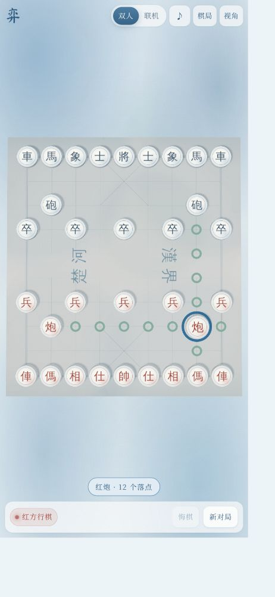
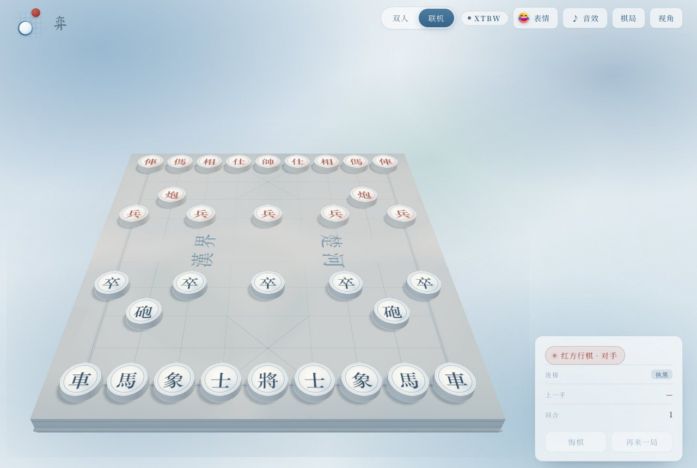
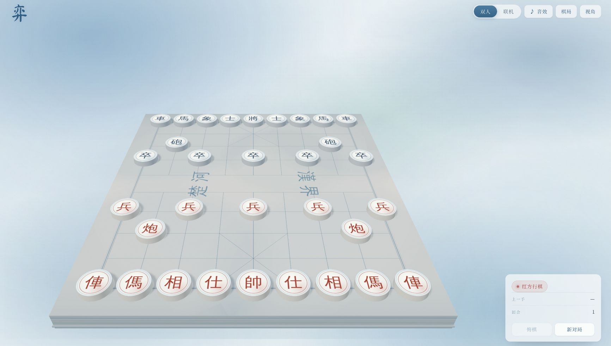
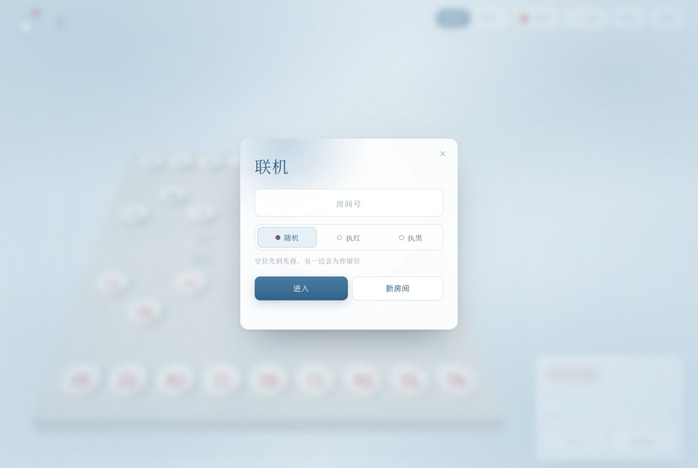
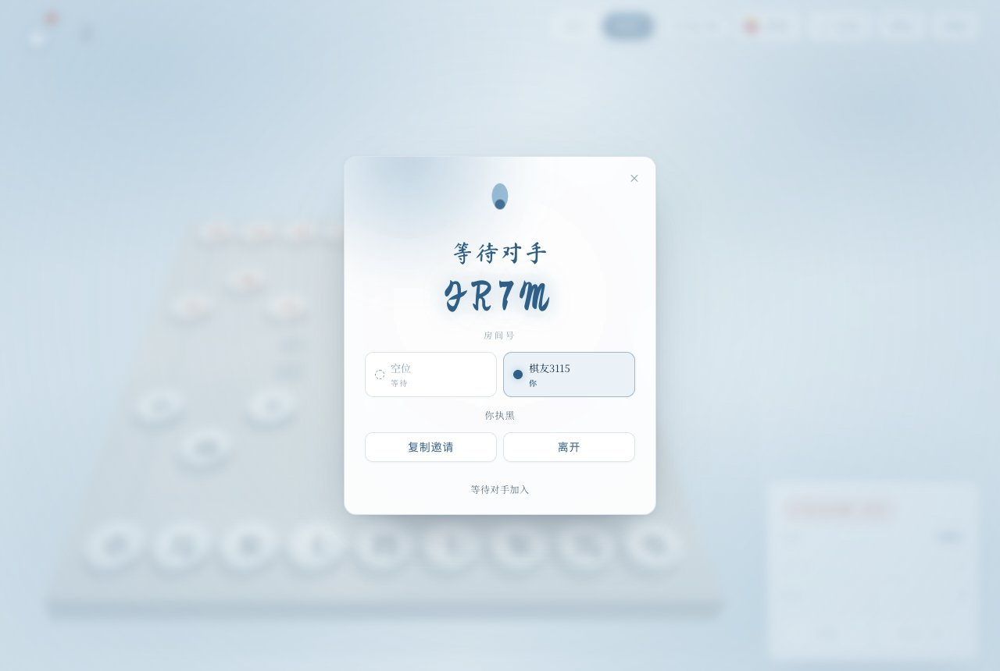
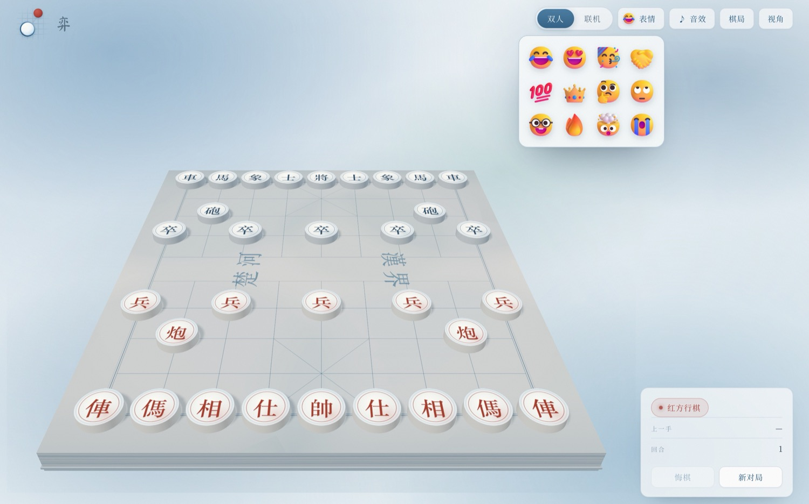
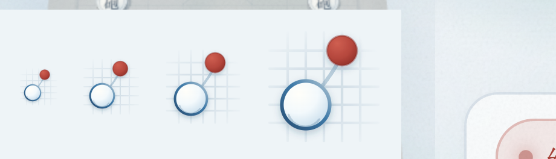
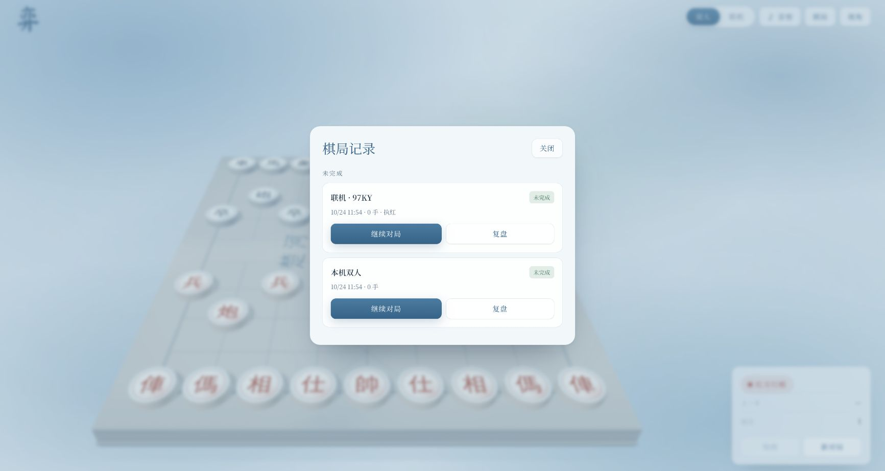

# 弈 · 三维中国象棋

Three.js 棋盘、Rapier 吃子物理、Colyseus 权威联机，以及前后端共用的象棋规则引擎。界面采用蓝色水彩与瓷白棋子，支持 3D 立体表情与联机对局，不含本地 AI 对战模式。



## 启动

需要 Node.js **22.12+** 和 pnpm 10。

```bash
pnpm install
pnpm server    # 终端 1：默认 ws://0.0.0.0:2567
pnpm dev       # 终端 2：默认 http://localhost:5173
```

前端服务地址可用 `VITE_SERVER_URL` 覆盖；服务端使用 `HOST`、`PORT`。手机与电脑处于同一网络时，通过电脑的局域网地址访问前端，前端会使用同一主机的 2567 端口。

```bash
pnpm test
pnpm typecheck
pnpm build
pnpm test:online
```

## 存档与历史

顶部「棋局」包含未完成、已结束的对局，以及完整中文棋谱。

- **本机双人**：走子、吃子与悔棋后自动保存。刷新会恢复上次的本机对局；「新对局」保留旧记录并创建新的对局。
- **继续对局**：从未完成记录恢复。本机存档会重放完整合法着法，重建悔棋栈与重复局面信息，不只是加载一个最终 FEN。
- **复盘**：使用「上一手」「下一手」浏览历史，棋盘不能操作；「返回对局」回到当前本机或联机局。复盘不会修改原存档。
- **联机续局**：服务端保存棋谱与座位预留，浏览器单独保存本方续局凭据。退出、关闭页面或掉线会暂停对局，不会因离开超过 30 秒自动判负。从「棋局 → 继续对局」回到原房间、原执方和最新服务端局面。
- 同一浏览器的两个标签页也分别保留红黑双方的凭据，不互相覆盖。观战者不能占用已预留的座位或走子。
- 服务端重启后，客户端可以按房间码重新唤起存档房间。凭据不匹配会拒绝入座；无凭据者只能占用尚未分配的座位或观战。

当前采用**浏览器本地存档 + 单进程服务端文件存储**，没有账号或跨设备同步。浏览器清除网站数据后，原座位的续局凭据也会清除；服务端上的棋谱文件仍在。不同端口属于不同网站存储空间。保存失败会明确提示，不会静默淘汰较早的未完成记录。

### 服务端数据目录

默认使用项目根目录的 `.data/games/`，与启动命令的工作目录无关。也可以指定持久化卷：

```bash
XIANGQI_DATA_DIR=/path/to/persistent/games pnpm server
```

每个房间有独立 JSON 文件，先写临时文件再原子替换，保存成功后才广播新局面。文件含完整棋谱、时间控制与座位凭据的 SHA-256 摘要；明文座位凭据只私发给所属客户端。双方同意重赛前，会把已完成对局另存到 `archive/<game-id>/`，新对局使用新的游戏 ID。

`.data/` 已加入 Git 忽略规则。部署时需保留该目录；容器只使用临时文件系统会在销毁后丢失服务端存档。这套存储暂不支持多个服务进程共写同一目录。

## 悔棋

- **本机**：每次撤回一手，恢复被吃棋子和此前局面，同时清除已选棋子、旧合法落点、悬空动画与物理碎片。撤回棋子有返回动画。
- **联机**：点击「悔棋」向对手请求，对手可以同意或拒绝。撤回最近自己的一手；如果对手已经应招，会一起撤回这两手。服务器校验请求对应的着法数并统一恢复双方局面和时钟。
- 新着法、掉线会取消过时的悔棋请求；观战者不能请求或批准悔棋。

## 视角与交互

「视角」提供自适应、俯视、斜俯和低角度四个预设，另有红黑翻转。选择保存在当前浏览器中。自适应模式在手机竖屏使用接近俯视的取景，保留棋子大小与完整棋盘。

- 轮次切换时显示红黑方行棋提示；联机下区分「你」与「对手」。
- 选中棋子轻微抬起，选中圈和合法落点脉冲，界面显示棋子及可落点数。
- 每一手的棋子文字始终朝向观看者：翻转视角或执黑时，棋面会跟着转 180°，而不是让人读倒字。棋盘本身保持物理朝向（楚河汉界仍按真实棋盘排布），只转棋子正面的字；侧面是普通圆柱，所以棋子整体外观不变。


- 落子播放位移动画、落地扩散圈；上一手保留起终点和方向箭头，并显示中文记谱。
- 吃子后被吃棋子交给 Rapier 抛掷；物理只负责呈现，胜负始终由规则引擎决定。
- 手机保留紧凑单行工具栏和操作区，禁止画布默认按压高亮、文本选择与长按菜单；房号输入框仍可正常编辑。



## 联机房间

「联机」面板先选执子：**随机 / 执红 / 执黑**，选择会记在浏览器里，下次打开仍是上次的偏好。随机表示坐第一个空位；指定颜色则是**愿望而非保证**——该色已有人时，伺服器把玩家放到另一边而不是拒之门外，界面会提示「座位已被占用，你执红/黑」。两个座位都坐满时以观战身份进入。

等待视图现在显示双方座位：两格分别是红、黑，写着对手的名字或「空位」，自己那一格标「你」，下面一行写明「你执红/执黑/观战中」并带上观战人数。邀请链接默认按对方的随机座位进入，对方想指定颜色就在面板里选。

- 座位占用与续局凭据一起持久化。占座在入座瞬间落盘，所以关页、掉线、服务端重启都不会把座位让给下一位，凭据也不会出现在广播消息或磁盘明文里。
- 「等待对手回到棋局」只在对手已有座位但暂时离线时出现；新开的空桌显示「等待对手加入」。





## 表情

顶部「表情」打开 12 个立体表情，选中后表情从发送方底线升起，带起跳、回弹、投影与收起的完整动画；同时播放为它单独设计的合成音，不引入额外采样授权。

- 素材是 Microsoft [Fluent Emoji](https://github.com/microsoft/fluentui-emoji) 的 3D 渲染（MIT），原样保存在 `apps/web/public/emoji/`，来源与许可证同目录可查。界面不改色、不加滤镜，只在呈现层做明暗双片、投影与倾角，让它读起来像浮在棋盘上的卡片。
- 联机下发送走服务端：`reaction` 消息由服务端校验表情 id、附上发送方座位后转发给其他客户端。发送方在按下的瞬间就本地显示并出声——表情是情绪，等一个往返读起来像点击没反应；回声因此不再回给发送方，不会重复播放。未知 id 与连发会被服务端丢弃（每个客户端 400ms 冷却）。表情不入棋谱、不落盘，重连后不会重放。
- 本机双人不需要服务端，表情直接由本机显示，升起在轮到行棋的一方。
- 静音用户不会初始化音频设备；语音与棋盘碰撞音共用同一个主音量。



## 音效

落子与吃子使用 [Kenney Board Game Pack](https://kenney.nl/assets/boardgame-pack) 的 CC0 筹码碰撞采样，吃子叠加两次碰撞；这是桌面筹码碰撞素材，不是这套象棋的专门实录。来源与许可证保存在 `apps/web/public/audio/`。

表情音效是**设计出来的一套**，不采样：12 个表情共用一个乐器组——木击表示认同、小钟堆表示喜悦、带通噪声扫频表示爆发，每个表情的音高、时值、滑音与衰减各自写定（`audio/reaction-voices.ts`），并统一压在 0.04–0.18 的峰值区间，连发不会削波。测试会检查每个上架表情都有语音、且没有超出这一响度带。

样本在第一次用户交互时解码，静音用户不会初始化音频设备或加载样本。静音会立即停止正在播放的碰撞声，开关状态会保留。采样加载或解码失败时回退到木质撞击合成；将军、终局和菜单提示仍使用 Web Audio 合成。

## 标志

原来的标题字「弈」换成了抽象标志：一段棋盘格上，红方棋子退场、瓷白棋子落位，中间一道湿笔连接两点。它读的不是某个具体字形，而是这套象棋最小的叙事单元——一步棋。标志画在 `apps/web/src/ui/brand-mark.svg`，同一份文件既内联进标题区（随字号缩放、任意 DPI 清晰），也作为 favicon 通过 Vite 的资源指纹输出。「弈」保留为标志旁的小字注记。



## 结构

```text
packages/rules/src/
  position.ts, movegen.ts    规则、FEN、走子与状态判定
  record.ts                 可持久化棋谱、合法重放与结果
  reactions.ts              表情目录，前后端共用的 id 与校验
  notation.ts               中文记谱
  ai/                       搜索库，仅保留代码与测试，未接入界面

packages/server/src/
  XiangqiRoom.ts            权威走子、预留座位、续局、协商悔棋、重赛、表情中继
  storage/matches.ts        原子文件存储
  index.ts                  Colyseus 启动入口

apps/web/src/
  game/game.ts              棋盘交互、动画、恢复、复盘与相机
  engine/                   Three.js 场景、棋盘、棋子、Rapier、表情贴纸层
  storage/archive.ts        浏览器对局档案与座位凭据
  net/online.ts             完整棋谱同步、重连与房间恢复
  ui/library.ts             棋局、复盘入口、视角与悔棋确认弹窗
  ui/room-dialog.ts         联机建房/入房、执子选择与座位名单
  ui/reactions.ts           表情面板
  ui/brand.ts, brand-mark.svg  标志
  ui/hud.ts                 轮次、选中、上一手和终局提示
  audio/                    碰撞采样播放、表情语音、提示音与静音

scripts/online-smoke.mjs     真实 SDK 与服务端重启测试
```

规则引擎零依赖，由 `VariantConfig` 与 `Geometry` 支持标准 9×10 中国象棋和 7×7 迷你象棋。当前 3D 界面与联机房间只开放标准中国象棋。走子编码为 `from | (to << 7)`；UCI 从红方底线计数，如 `h2e2` 对应「炮二平五」。开局 perft 深度 1–4 为 44 / 1920 / 79 666 / 3 290 240。

联机使用纯消息协议。客户端只提交 UCI，收到服务端完整棋谱后才实际落子。`identity` 私发座位凭据；`snapshot`、`move`、`reset` 同步棋谱与结果；`seats` 同步执方与双方在线状态；`undo-request` / `undo-answer` 处理协商悔棋；`reaction` 把已校验的表情转发给其他客户端。断线后先阻止输入，完整局面同步完成后才恢复。

## 验证（2026-10-25）

- **111 项单元/回归测试**：规则、perft、中文记谱、音效编排与采样、表情目录与语音、完整棋谱重放、浏览器存档、磁盘保存失败、座位凭据、指定执子与回退、协商悔棋、表情中继与冷却、离线暂停和时钟边界。
- **类型检查、生产构建**：rules、server、web 检查通过。Three.js 主包和懒加载 Rapier 仍有构建体积提示。
- **真实联机协议测试**：`pnpm test:online` 自动启动独立服务，连接多个真实 SDK 客户端，检查红黑座位、观战拒绝、双向走子、协商悔棋、表情转发给对手与观战者、不回声给发送方、未知 id 被丢弃、离开暂停、服务端进程重启后原座位恢复、续局吃子、认输结果以及双方同意重赛后新游戏 ID。测试使用临时目录，结束后清理，不修改实际存档。默认测试端口 2569，可用 `XIANGQI_TEST_PORT` 覆盖。
- **真实 Chrome 页面**：本机走子、刷新恢复后悔棋、棋局列表、逐手复盘、俯视预设；两个标签页联机互走、同意悔棋后同步撤回、刷新后从历史记录恢复原执红座位；表情面板在桌面与 390×844 手机视口开启、选中后贴纸按预期升起并在 3 秒后收起，联机下发送方页与对手页各出现一张升起在发送方的贴纸且发送方只有一张（无重复），手机视口无横向溢出（390/390）；两浏览器分别选执黑与执黑建房/入房，验证先到者拿黑、后到者自动落红并出现「座位已被占用」提示，等待面板座位格与「你执黑」摘要正确；翻转视角与执黑入座后棋子文字均正立；房间面板在 390×844 与 320×568 视口无溢出。

上述验证不代表跨设备账号同步、实体手机全机型验证或多人高并发压力测试；这些尚未实现或未在本轮验证。表情语音只做了单元测试与浏览器内实听，没有做客观频谱或响度测量。


